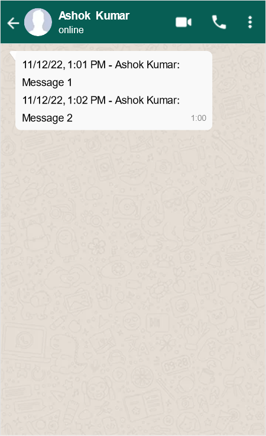

# WhatsApp Chat Log Parser

_(Developed assuming WhatsApp Messenger Version 2.22.23.77)_

## Setup

This project uses [uv](https://docs.astral.sh/uv/) for environment management. Install it by following the
[instructions here](https://docs.astral.sh/uv/getting-started/installation/), then let uv create the project
environment (it will also fetch the pinned Python version automatically):

```bash
uv sync --group analysis
```

The `analysis` dependency group is only needed for the analysis notebook. The parser itself uses only the Python
standard library, so `parser.py` can be run with any Python v3.10 or higher.

## Usage

- Export your WhatsApp chat as a `.txt` file by following the instructions
  [here](https://faq.whatsapp.com/1180414079177245/?helpref=uf_share).
- Run the `parser.py` script to convert your exported chat logs into a CSV file.

    ```bash
    uv run parser.py [INPUT] [OUTPUT]
    ```

- Change the variable `DATA_FILE` in `stats.py` to match your CSV filename.
- Open the analysis notebook with [marimo](https://marimo.io/) to view the analysis and perform your own:

    ```bash
    uv run marimo edit stats.py
    ```

  To run it non-interactively as an app instead, use `uv run marimo run stats.py`.

`stats.py` is a [marimo](https://marimo.io/) notebook stored as a plain Python file. Unlike a Jupyter `.ipynb`, it
stores no cell outputs, so there is no risk of accidentally committing sensitive chat contents from output cells, and
no pre-commit hook is needed.

## Assumptions

### Start of records

Since WhatsApp Messenger doesn't export files using proper delimiters, it is impossible to differentiate a new message
from the previous message's contents.

For example, let's say person "Ashok Kumar" sent the following message at 1:00 PM on 2022/11/12.



WhatsApp would export a record for this message as -

```
11/12/22, 1:00 PM - Ashok Kumar: 11/12/22, 1:01 PM - ABC: Message 1
11/12/22, 1:02 PM - Ashok Kumar: Message 2
```

There is no way to tell that the second line is actually part of the previous record's message, since WhatsApp does not
include any delimiter to identify when a message for a particular record is over. Thus, I've made the assumption that
any line that begins with `[mm]/[dd]/[yy], [h]:[mm] AM|PM - ` is the beginning of a new record. Errors of the kind I
mentioned will arise, but they are unavoidable.

### Names do not contain `:`

Regular messages are identified by the name and contents being separated by the `:` (colon) character.

```
11/12/22, 1:00 PM - Ashok Kumar: 11/12/22, 1:01 PM - ABC: Message 1
```

In case names can contain `:`, it would be impossible to identify what part of the string is the name, and
what part the message.

```
11/12/22, 1:00 PM - A:s:h:o:k: K:u:m:a:r: 11/12/22, 1:01 PM - ABC: Message 1
```

I make the fairly reasonable assumption that names do not contain `:`. This allows detection of a name as
the string before the first `:`.
